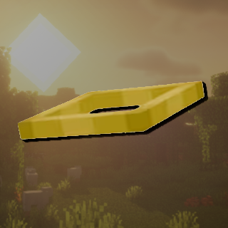

# LabyMod Offline Cosmetics

**Bring your LabyMod experience back to offline-mode servers.**

Restore cosmetics, emotes, premium Minecraft skins and capes, even when playing without online-mode authentication.

 

 

*An unofficial client-side LabyMod addon focused on restoring the features you would normally lose on offline-mode servers.*

---

## ✨ Features

Offline Cosmetics bridges the gap between offline-mode Minecraft servers and your authenticated Minecraft profile, bringing back features that would otherwise be unavailable.

| Feature | Description |
|:---|:---|
| **Cosmetics & Emotes** | Restore the visibility of LabyMod cosmetics and custom emotes. |
| **Premium Skins** | Retrieve your authentic Minecraft account skin through Mojang's APIs. |
| **Cape Rendering** | Restore premium account capes through the custom game profile wrapper. |
| **Profile Mapping** | Automatically associate your offline player profile with your authenticated Minecraft profile. |
| **Independent Settings** | Enable or disable cosmetics and skin restoration individually. |
| **Multi-Version Support** | Compatibility implementations covering a wide range of Minecraft versions. |

---

## ⚙️ Configuration

Offline Cosmetics integrates directly into LabyMod's native addon settings interface.

You can independently control the addon and its individual modules without having to modify configuration files manually.

| Setting | Description |
|:---|:---|
| **Addon enabled** | Completely enable or disable Offline Cosmetics. |
| **Cosmetics** | Toggle the extraction and application of LabyMod cosmetics and emotes. |
| **Skin** | Toggle the injection of authenticated Minecraft skin profiles. |

This allows you to choose exactly how you want to use the addon:

- Cosmetics only.
- Premium skins only.
- Both cosmetics and premium skins.
- Completely disabled.

Offline Cosmetics integrated directly into LabyMod's settings interface.

---

## 🤝 Credits & Attribution

Offline Cosmetics is based on the original project developed by **Xqedii**.

**Original repository:** [Xqedii/Offline-Cosmetics](https://github.com/Xqedii/Offline-Cosmetics)

This repository is a continuation of that original work, with additional development, maintenance, compatibility improvements and support for newer Minecraft versions.

The original implementation and foundational architecture belong to **Xqedii**.

I've also personally contacted Xqedii to discuss continuing development of the project, and he is aware of this repository.

Please consider visiting the original repository and supporting the original author!

---

## ⚖️ Disclaimer

LabyMod Offline Cosmetics is an unofficial, community-developed client-side addon.

This project is **not affiliated with, endorsed by, or maintained by LabyMod, Mojang Studios or Microsoft**.

Minecraft is a trademark of Microsoft Corporation.

All profile mapping and cosmetic restoration operations are performed client-side. This addon does not modify the authentication configuration or authentication framework of the server you connect to.

---

**LabyMod Offline Cosmetics**

*Keeping your cosmetics close, even when playing offline.*

 

[**Download Latest Release**](https://github.com/notfuz/Offline-Cosmetics/releases) · [**Report an Issue**](https://github.com/notfuz/Offline-Cosmetics/issues) · [**View Source Code**](https://github.com/notfuz/Offline-Cosmetics)

Developed and maintained by <a href="https://github.com/notfuz">notfuz</a>

