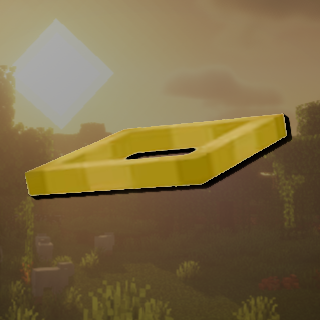

 <div align="center">



# LabyMod Offline Cosmetics

**Bring your LabyMod experience back to offline-mode servers.**

Restore cosmetics, emotes, premium Minecraft skins and capes, even when playing without online-mode authentication.

[](../../releases/latest)
[](../../actions/workflows/build.yml)
[](../../releases)
[](../../stargazers)

<br>


<br>

*An unofficial client-side LabyMod addon focused on restoring the features you would normally lose on offline-mode servers.*

</div>

---

## ✨ Features

Offline Cosmetics bridges the gap between offline-mode Minecraft servers and your authenticated Minecraft profile, bringing back features that would otherwise be unavailable.

| Feature | Description |
|:---|:---|
| **Cosmetics & Emotes** | Restore the visibility of LabyMod cosmetics and custom emotes. |
| **Premium Skins** | Retrieve your authentic Minecraft account skin through Mojang's APIs. |
| **Cape Rendering** | Restore premium account capes through the custom game profile wrapper. |
| **Profile Mapping** | Automatically associate your offline player profile with your authenticated Minecraft profile. |
| **Independent Settings** | Enable or disable cosmetics and skin restoration individually. |
| **Multi-Version Support** | Compatibility implementations covering a wide range of Minecraft versions. |

## 🎮 Minecraft Compatibility

Offline Cosmetics maintains compatibility across multiple Minecraft generations, including older legacy versions and newer releases.

| Minecraft Version | Compatibility |
|:---|:---:|
| **1.8.9 – 1.21.8** | ✅ Supported, with listed exceptions |
| **1.21.9 – 1.21.11** | ⏳ Support under consideration |
| **26.1 – 26.3** | ✅ Supported |

> [!NOTE]
> Compatibility can vary between individual Minecraft versions. Check the project's releases and issue tracker for known limitations and version-specific information.

---

## 📥 Installation

Getting started is simple. You only need the compiled production addon and an existing LabyMod installation.

1. Head over to the [**latest GitHub release**](../../releases/latest).
2. Download `OfflineCosmeticsLabyMod-release.jar`.
3. Locate your Minecraft/LabyMod installation directory.
4. Open the `addons` folder.
5. Place the downloaded JAR inside the folder.
6. Restart your Minecraft client.

<details>
<summary><strong>⚠️ Important installation information</strong></summary>

Only install the production release JAR ending in `-release.jar`.

The repository generates several intermediate build files, including `api`, `core`, `game-runner` and development artifacts. These are not standalone addons and will not work when installed directly.

Make sure you download:

`OfflineCosmeticsLabyMod-release.jar`

</details>

---

## ⚙️ Configuration

Offline Cosmetics integrates directly into LabyMod's native addon settings interface.

You can independently control the addon and its individual modules without having to modify configuration files manually.

| Setting | Description |
|:---|:---|
| **Addon enabled** | Completely enable or disable Offline Cosmetics. |
| **Cosmetics** | Toggle the extraction and application of LabyMod cosmetics and emotes. |
| **Skin** | Toggle the injection of authenticated Minecraft skin profiles. |

This allows you to choose exactly how you want to use the addon:

- Cosmetics only.
- Premium skins only.
- Both cosmetics and premium skins.
- Completely disabled.

<div align="center">


<sub>Offline Cosmetics integrated directly into LabyMod's settings interface.</sub>

</div>

---

## 🔍 How It Works

### Profile and UUID Mapping

Minecraft offline-mode servers generate player UUIDs independently of Mojang's authenticated account system.

Normally, this prevents LabyMod from associating your offline player profile with your actual Premium Minecraft account.

Offline Cosmetics addresses this by mapping your offline session UUID to your authenticated Minecraft UUID.

Using this mapping, the addon can retrieve the associated account information and apply the relevant profile data locally.

### Minecraft 1.21.9 and Newer

Minecraft 1.21.9 introduced a significant change to the `GameProfile` implementation, converting it into a record.

This meant that the previous profile replacement approach could no longer be used.

To accommodate this change, newer implementations create replacement profiles containing the authenticated Minecraft UUID when relevant player and tab-list entries are created.

Premium skin information is then retrieved from Mojang in the background.

### Minecraft 26.x

Minecraft 26.x implementations use separate version-specific source directories to accommodate newer game changes and compatibility requirements.

These implementations handle the necessary profile mapping and related version-specific behaviour.

You can find them under:

`game-runner/src/v26_*/`

---

## 🛠️ Building From Source

Want to compile Offline Cosmetics yourself or contribute to development?

You can build the project locally using Gradle.

### Requirements

- **JDK 25** or newer.
- **Git** command-line tools.
- An active internet connection for Gradle dependency downloads.
- Windows, Linux or macOS.

> [!NOTE]
> Minecraft 26.1 and newer require Java 25. Older Minecraft implementations have their respective compilation requirements handled by the project's Gradle configuration.

### 1. Clone the repository

```bash
git clone https://github.com/notfuz/Offline-Cosmetics.git
cd Offline-Cosmetics
```

### 2. Build the project

**Windows (PowerShell / CMD)**

```powershell
.\gradlew.bat build
.\gradlew.bat createReleaseJar
```

**Linux / macOS**

```bash
chmod +x gradlew
./gradlew build
./gradlew createReleaseJar
```

### 3. Locate the production JAR

Once Gradle finishes successfully, the production addon will be generated in:

```text
build/libs/OfflineCosmeticsLabyMod-release.jar
```

This is the finished JAR you can install directly into your LabyMod `addons` directory.

---

## 🤖 Automated Builds & Releases

This repository uses **GitHub Actions** to automate compilation, verification and production releases.

The workflow is maintained in:

`.github/workflows/build.yml`

### Continuous Integration

Build verification runs automatically when:

- Code is pushed to `main` or `master`.
- A pull request targets `main` or `master`.
- A workflow is manually triggered through GitHub Actions.

Successful builds generate downloadable production JAR artifacts.

### Publishing a Release

Production releases are generated using Git version tags.

To publish a new version, create and push a version tag:

```bash
git tag v1.1.0
git push origin v1.1.0
```

GitHub Actions will automatically:

1. Detect the pushed version tag.
2. Extract the addon version from the tag.
3. Compile the project using the release version.
4. Generate the production release JAR.
5. Upload the compiled JAR as a build artifact.
6. Create a GitHub Release and attach the finished JAR.

For example:

| Git Tag | Addon Version |
|:---|:---|
| `v1.0.0` | `1.0.0` |
| `v1.1.0` | `1.1.0` |
| `v2.0.0` | `2.0.0` |

This keeps the release process consistent and removes the need to manually compile and upload production builds.

---

## 🤝 Credits & Attribution

Offline Cosmetics is based on the original project developed by **Xqedii**.

**Original repository:** [Xqedii/Offline-Cosmetics](https://github.com/Xqedii/Offline-Cosmetics)

This repository is a continuation of that original work, with additional development, maintenance, compatibility improvements and support for newer Minecraft versions.

The original implementation and foundational architecture belong to **Xqedii**.

I've also personally contacted Xqedii to discuss continuing development of the project, and he is aware of this repository.

Please consider visiting the original repository and supporting the original author!

---

## ⚖️ Disclaimer

LabyMod Offline Cosmetics is an unofficial, community-developed client-side addon.

This project is **not affiliated with, endorsed by, or maintained by LabyMod, Mojang Studios or Microsoft**.

Minecraft is a trademark of Microsoft Corporation.

All profile mapping and cosmetic restoration operations are performed client-side. This addon does not modify the authentication configuration or authentication framework of the server you connect to.

---

<div align="center">

**LabyMod Offline Cosmetics**

*Keeping your cosmetics close, even when playing offline.*

<br>

[**Download Latest Release**](../../releases/latest) · [**Report an Issue**](../../issues) · [**View Source Code**](../../)

<sub>Developed and maintained by <a href="https://github.com/notfuz">notfuz</a></sub>

</div>
